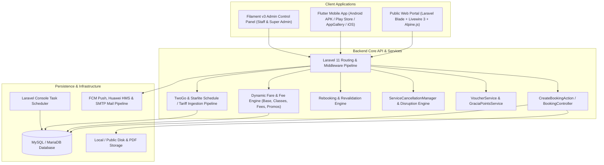

# Amiga Gracia Travel Services 🚢✈️🏝️

An enterprise-grade, multi-platform travel booking, ticketing, and transportation management ecosystem for ferry transit, commercial airlines, and curated tour packages. The platform combines a **Laravel 11 backend and API**, a **Filament v3 Admin Control Panel**, a **Livewire 3 + Alpine.js + Tailwind CSS public web portal**, and a **Flutter mobile application** (Android APK, Google Play Store, Huawei AppGallery, and iOS).

---

## 📑 Table of Contents

1. [System Architecture & Topology](#1-system-architecture--topology)
2. [Environment Setup & Installation](#2-environment-setup--installation)
3. [Building & Deployment Pipeline](#3-building--deployment-pipeline)
4. [Admin Control Panel (Filament v3)](#4-admin-control-panel-filament-v3)
5. [Core Calculations & Business Rules Engine](#5-core-calculations--business-rules-engine)
6. [Public Website & Livewire Frontend](#6-public-website--livewire-frontend)
7. [Flutter Mobile Application (APK, Play Store, AppGallery, iOS)](#7-flutter-mobile-application)
8. [Scheduled Background Tasks & Cron Jobs](#8-scheduled-background-tasks--cron-jobs)
9. [Known Discrepancies & Engineering Notes](#9-known-discrepancies--engineering-notes)

---

## 1. System Architecture & Topology



---

## 2. Environment Setup & Installation

### 2.1 Prerequisites
- **PHP**: `>= 8.2` with `pdo_mysql`, `bcmath`, `ctype`, `fileinfo`, `mbstring`, `openssl`, `tokenizer`, `xml`, `gd`, `zip`.
- **Composer**: Latest 2.x
- **Database**: MySQL `>= 8.0` or MariaDB `>= 10.5`
- **Node.js & npm**: Node `>= 18.x`
- **Flutter SDK**: `>= 3.19.0` (Dart SDK `>= 3.0.0 < 4.0.0`)
- **Android Studio & SDK**: Platform Tools, Build-Tools, Command-line Tools, Android SDK Platform 34+

### 2.2 Backend Setup (Laravel)
```powershell
# 1. Clone repository
git clone <repository_url> AmigaTravel
cd AmigaTravel

# 2. Install PHP & Node dependencies
composer install
npm install
npm run build

# 3. Environment configuration
cp .env.example .env
php artisan key:generate

# Configure .env with your database credentials:
# DB_CONNECTION=mysql
# DB_HOST=127.0.0.1
# DB_PORT=3306
# DB_DATABASE=amiga_travel
# DB_USERNAME=root
# DB_PASSWORD=

# 4. Migrate and seed database
php artisan migrate:fresh --seed

# 5. Create storage symlink
php artisan storage:link

# 6. Start local development server
php artisan serve --host=0.0.0.0 --port=8000
```
*(Default super admin credentials: `admin@test.com` / `password`)*

### 2.3 Mobile App Setup (Flutter)
```powershell
cd flutter_app

# Install Flutter packages
flutter pub get

# Configure API Endpoint in lib/main.dart (UserSession class):
# static String getBaseUrl() => 'http://<YOUR_LOCAL_IP>:8000';

# Run on connected device or emulator
flutter run
```

---

## 3. Building & Deployment Pipeline

### 3.1 Android APK & Google Play Store (Package: `com.amiga.travel.flutter_app`)
```powershell
cd flutter_app

# Build universal release APK
flutter build apk --release

# Copy APK to public download directory for direct website downloads
Copy-Item "build\app\outputs\flutter-apk\app-release.apk" -Destination "..\public\downloads\amiga-travel.apk" -Force

# Build Android App Bundle for Google Play Store
flutter build appbundle --release
```

### 3.2 Huawei AppGallery (Package: `com.amigagracia.app`)
Huawei AppGallery requires package identifier `com.amigagracia.app`. An automated PowerShell script handles the environment switch:
```powershell
# Run from repository root:
.\build-huawei.ps1
```
The script outputs:
- `public\downloads\huawei-release.aab` (AppGallery Connect upload)
- `public\downloads\huawei-release.apk` (Direct distribution)

### 3.3 iOS Release via Codemagic CI/CD
Defined in [`codemagic.yaml`](codemagic.yaml):
- Target machine: `mac_mini_m1` (macOS)
- Bundle Identifier: `com.amiga.travel.flutterApp`
- Pipeline automatically installs CocoaPods, fetches signing certificates from App Store Connect, compiles IPA, and exports to artifacts.

### 3.4 Docker & Containerized Hosting (Railway / Render)
- `Dockerfile`: Multi-stage Alpine PHP 8.3 container running Node builds and PHP extensions.
- `scripts/railway-start.sh`: Generates dynamic runtime `.env`, executes migrations and `storage:link`, clears caches, and boots the application.

---

## 4. Admin Control Panel (Filament v3)

Accessible at `/admin` with the `admin` authentication guard.

### 4.1 Permission Engine & Staff Roles
- **Super Admin**: Full unrestricted access, bypasses all permission checks.
- **Admin**: Full operational access across all resources.
- **Staff / Finance**: Controlled by 8 distinct permission groups configured on the `User` model (`hasAdminPermission()`):
  1. `Bookings`: Access to Bookings, Transactions, and Receipts.
  2. `Travel`: Access to Routes, Schedules, Ferry/Airline management, Hotels, Vouchers, Discounts, and Service Disruptions.
  3. `Airline`: Access to Airline Seats and Baggage Settings.
  4. `Ferry`: Access to Vehicle / RORO cargo rates.
  5. `Management`: Access to Promotional Tickets and Tour Packages.
  6. `Settings`: Access to Website Settings, Mobile App Settings, Payment Settings, Proofs, and Gracia Rules.
  7. `Reports`: Access to Overall Reports and Staff Performance metrics.
  8. `Administration`: Access to Staff Accounts, Inquiries, and Mobile APK Users.

### 4.2 Custom Admin Pages
| Page | Nav Group | Key Capabilities & Business Logic |
| :--- | :--- | :--- |
| **System Control Hub** (`SystemDashboard`) | Administration | *Super Admin only.* Real-time database telemetry, query latency tracking, table storage footprint (MB), 24h crash log stream with stack trace viewer, log purge, and live test crash alert dispatcher. |
| **Payment Settings** (`ManagePaymentSettings`) | Settings | Web admin fees (standard vs short-haul), transaction fees, land accommodation fees, revalidation fees, cancellation surcharge %, rebooking surcharge %, 2-hour SLA guarantee voucher toggle, GCash/Bank QR code upload. |
| **Mobile App Settings** (`ManageAppSettings`) | Settings | Mobile app maintenance break controller: toggles maintenance mode, estimated duration, custom client messages, and general browsing allowance. |
| **Website Settings Visual Builder** (`ManageWebsiteSettings`) | Settings | Live iframe visual builder with section hotspots, hero carousels, promotion slides, marketing banners, header/footer configuration, and SEO metadata. |
| **Rebookings Management** (`ManageRebookings`) | Bookings | Real-time 3s polling queue for voluntary and disruption rebookings. Displays requested dates/times, preferred vessel/accommodation, fare differences, revalidation fees. Actions: *Approve Rebooking* (with e-ticket upload) and *Reject Rebooking*. |
| **Refunds Management** (`ManageRefunds`) | Bookings | Real-time 3s polling queue for customer and operator cancellation refunds. Displays customer's GCash/bank details, non-refundable fees retained, and net refund due. Actions: *Customer Docs* modal (ID, ticket, letter) and *Process Refund* (upload transfer receipt). |
| **Proofs & Retention** (`ManageProofs`) | Reports | Live gallery of payment, rebooking, and refund disbursement proofs. Configurable auto-delete retention policy (e.g. 30 days) with automated pre-retention ZIP backup exports. |
| **Receipts Management** (`ManageReceipts`) | Reports | On-demand generation and bulk ZIP streaming of Official Receipts, Travel Acknowledgements, and Refund Acknowledgement PDFs. |
| **Schedule Import Center** (`ImportSchedules`) | Travel & Tours | Starlite timetable expansion with June 2026 tariff matrix, 2GO multi-sheet parser, custom CSV/Excel importer, and CSV template generator. |
| **Overall Reports** (`OverallReports`) | Reports | Interactive analytics dashboard: 7 KPI cards with sparklines, ApexCharts revenue trends, booking volumes, transport mode distribution, top routes, passenger demographics, and PDF/CSV export. |
| **Staff Performance** (`StaffPerformance`) | Reports | Staff leaderboard, processed transaction count, verified revenue total, completion rate %, staff audit modal, and PDF/CSV export. |
| **My Page** (`MyPage`) | My Account | Authenticated staff personal dashboard with handled transaction history and quick export buttons for personal transactions, system bookings, routes, and schedules. |
| **Admin Notifications** (`AdminNotifications`) | My Account | Live 3.5s heartbeat notification center with dual-tone Web Audio chimes, search, mark read/unread, and bulk deletion. |
| **Airline Seats & Accommodations** (`ManageTransportAccommodation`) | User Menu | Mode switcher (Airline Seats vs Ferry Accommodations), operator filters, class and bed allocation management. |

### 4.3 Filament Resources & Relation Managers
- **`BookingResource`**: Complete booking lifecycle management, review claim locks, soft-delete restoration, and ticket generation. Relation managers: `PassengersRelationManager`, `AccommodationsRelationManager`, `TransportClassesRelationManager`.
- **`TransactionResource`**: Payment verification gate with a 5-minute review claim timer lock, payment proof zoom viewer, confirmation URL/PDF attacher, and rejection dispatcher.
- **`ServiceCancellationResource`**: Carrier/route/vehicle disruption engine. Auto-deactivates schedules, flags affected bookings, and generates 7-day replacement timetables.
- **`FerryRouteResource`**: Route registry with `SchedulesRelationManager` for managing departures, vessel names, pricing, and accommodation classes.
- **`ApkUserResource`**: Mobile app user accounts, install source tracking (`Google Play`, `AppGallery`, `Direct APK`), deletion grace period management, points balance adjustments, and `GraciaPointLedgersRelationManager`.
- **`VoucherResource`**: Discount codes, minimum spend, operator/route constraints, usage limits, and `RedemptionsRelationManager`.
- **`DiscountResource`**: Government and student discount configuration (Senior Citizen, PWD, Student, Child, Infant).
- **`GraciaEarningRuleResource`**: Spend threshold and point awarding rules.
- **`VehicleRateResource` & `VehicleBrandResource`**: RORO vehicle classification, dimensions, and route-specific tariff matrices.
- **`AirlineBaggageRuleResource`**: Baggage weight allowances and fees for domestic and international flights.
- **`TourResource`**: Curated tour packages, itineraries, inclusions, exclusions, and departure dates.

---

## 5. Core Calculations & Business Rules Engine

### 5.1 Fare Pricing & Passenger Multipliers
- **Base Ticket Fare Formula**:
  $$\text{grossTicketFare}_i = (\text{depBasePrice} + \text{depClassPrice} + \text{retBasePrice} + \text{retClassPrice}) \times \text{paxMultiplier}_i$$
- **Passenger Multipliers (`paxMultiplier`)**:
  - Regular Airline: Adult = `1.0`, Minor (7–11) = `0.5`, Child (2–6) = `0.5`, Infant (<2) = `0.5`.
  - Regular Ferry: Adult = `1.0`, Child/Minor (2–11) = `0.5`, Infant (<2) = `1.0` *(ticket issued at port)*.
  - Driver (when `has_vehicle = true`): `paxMultiplier = 0.0` *(ticket fare bundled into cargo rate)*.
  - Promo / Super Promo Rates: `paxMultiplier = 1.0` for all ages (discounts disabled).

### 5.2 Mandated Passenger Discounts
- **Senior Citizen (R.A. 9994: 20% Discount + 12% VAT Exemption)**:
  $$\text{discountedRate} = \text{grossFare} \times 0.80$$
  $$\text{netSeniorFare} = \frac{\text{discountedRate}}{1.12}$$
  $$\text{seniorDiscount} = \text{round}(\max(0.0, \text{grossFare} - \text{netSeniorFare}), 2) \quad (\approx 28.5714\% \text{ total reduction})$$
- **Student & PWD**:
  $$\text{discountAmount} = \text{round}\left(\text{grossFare} \times \frac{\text{percentage}}{100}, 2\right)$$

### 5.3 Platform Service Fees (Short-Haul vs. Long-Haul)
- **Short-Haul Criteria**: Ferry trips with effective duration $< 300\text{ minutes}$ ($5\text{ hours}$).
- **Fee Matrix**:
  - Standard (Long-Haul): Web Admin Fee = `₱175.00/pax`, Transaction Fee = `₱345.00/pax`.
  - Short-Haul Ferry: Web Admin Fee = `₱30.00/pax`, Transaction Fee = `₱70.00/pax`.
  - Hotel Service Fee: `₱5,000.00` flat per booking if land accommodations are selected.

### 5.4 Rolling Cargo & RORO Vehicle Tariffs
- **Advance Cutoff**: Strict `72-hour` ($3\text{ days}$) advance booking cutoff in `Asia/Manila` time.
- **Starlite Tariff Resolution**: Resolved via `VehicleRouteRate` for origin-destination pairs across 4 tiers:
  1. `Motorcycle`
  2. `Below 3 meters` (Tricycle, Multicab)
  3. `3 to 3.9 meters` (Small Car: Wigo, Brio, Mirage, Swift, S-Presso)
  4. `4 to 4.9 meters` (Sedan / SUV / Pickup / Van)

### 5.5 Rebooking & Rescheduling Calculations
- **Eligibility**: Non-promotional tickets only. Permitted $> 24\text{ hours}$ before departure (or $> 5\text{ minutes}$ post-departure on Starlite).
- **Surcharges**:
  - Within 5-minute creation grace window: `0%` surcharge, `₱0` revalidation fee.
  - Ferry before departure: `15%` surcharge.
  - Ferry after departure (Starlite): `35%` surcharge.
  - Airline: `15%` surcharge.
  - Revalidation Fee: `₱250.00` per passenger item.
- **Total Rebooking Due**:
  $$\text{rateDiff} = \max(0.0, \text{newFare} - \text{originalFareBase})$$
  $$\text{totalToPay} = \text{rateDiff} + \left(\text{originalFareBase} \times \frac{\text{surchargePct}}{100}\right) + (\text{revalidationFee} \times N_{\text{pax}})$$

### 5.6 Cancellation, Refunds & Disruption Policies
- **5-Minute Grace Window**: 100% full refund with `0%` cancellation fee and full fee reimbursement.
- **Voluntary Cancellation**:
  - Non-refundable fees retained: Web Admin Fee, Transaction Fee, Revalidation Fee.
  - Surcharges: Ferry Before Departure = `25%`, Ferry After Departure = `40%` (or 100% forfeited if non-Starlite), Airline Before Departure = `40%` (100% forfeited after departure).
- **Service Disruption (Operator Cancellation)**:
  - Disruption Refund: `0%` cancellation surcharge. 100% of the net ticket fare refunded.
  - Disruption Replacement: Free transfer to eligible replacement schedules without revalidation fees.

### 5.7 Party Accompaniment Protection Rules
1. **Single-Adult Lock**: If active passengers contain only 1 adult alongside minors/children, all passengers must be cancelled, refunded, or rebooked together.
2. **Selected Group Accompaniment**: Non-adults cannot act without at least 1 accompanying adult.
3. **Remaining Group Accompaniment**: Adults cannot be removed if it leaves minors/children behind on the booking without adult supervision.

### 5.8 Loyalty & Rewards Engine
- **Gracia Points**:
  $$\text{eligibleSpend} = \max(0.0, \text{totalPrice} - \text{webAdminFee} - \text{transactionFee})$$
  $$\text{pointsEarned} = \left\lfloor \frac{\text{eligibleSpend} \times 100}{\text{spendThresholdCentavos}} \right\rfloor \times \text{pointsAwarded}$$
  - Conversion: $1\text{ Point} = ₱1.00$. Deducted at checkout. Reversible on cancellation.
- **Referral Rewards**:
  - Referee: 5% starter voucher (capped at ₱50).
  - Referrer: $\le 3$ completed referrals = 5% voucher (capped at ₱300); $> 3$ referrals = 10% voucher (capped at ₱500).
- **2-Hour SLA Verification Guarantee**:
  - Automatically issues a ₱500 voucher (`SLA-XXXXXXXX`, valid for 3 months) if payment proof verification exceeds 2 hours.

---

## 6. Public Website & Livewire Frontend

### 6.1 Public Page Catalog
- **Home (`/`)**: Airpaz-style booking search engine, port swapping, dynamic calendar, RORO vehicle selector, video showcase, promotional lightboxes, and popular destinations.
- **Schedules (`/schedules`)**: Interactive timetable browser with live departure countdowns (`Departed` vs `Book Now`).
- **Tour Packages (`/tour-package` & `/tours/{id}`)**: Domestic and international tour catalog, itinerary timelines, and inclusion matrices.
- **App Download (`/download`)**: Dynamic app versioning and APK file size calculator with store badges.
- **Informational & Support Pages**: About Us (`/about`), Services (`/services`), Contact Us (`/contact-us`), FAQs (`/faqs`), and Privacy Policy (`/privacy-policy`).

### 6.2 Interactive Livewire Components
1. **`BookingForm`**: 5-step checkout wizard (Trip Details $\rightarrow$ Schedules $\rightarrow$ Passengers $\rightarrow$ Summary $\rightarrow$ Checkout). Handles passenger manifests, student ID uploads, international passport validation, baggage options, vouchers, and Gracia points.
2. **`BookingLookup`**: Self-service booking tracker, live 5-minute cancellation timer, multi-passenger selection, email OTP verification, refund disbursement form, and rebooking scheduler.
3. **`BookingReschedule`**: Disruption management wizard for selecting replacement schedules or requesting 100% ticket base refunds.
4. **`PaymentProof`**: 1-hour payment deadline countdown, reference number input, payment proof receipt upload, and auto-cancellation trigger.
5. **`UserDashboard`**: Customer portal displaying booking history, status badges, e-tickets, and payment receipts.

---

## 7. Flutter Mobile Application

Located in `flutter_app/`.

### 7.1 Multi-Store Build System & Store Identification
- **Package Identifiers**:
  - Google Play & Website Direct APK: `com.amiga.travel.flutter_app`
  - Huawei AppGallery: `com.amigagracia.app` (compiled via `build-huawei.ps1`)
  - Apple App Store: `com.amiga.travel.flutterApp` (compiled via `codemagic.yaml`)
- **Store Detection & OTA Update Checker**:
  - Automatically identifies install source (`playStore`, `appGallery`, `website`, `appStore`).
  - Queries `GET /api/app-version` on launch and resume. If an update is required, displays a non-dismissible modal routing users to their installation store or triggering an in-app APK download with live progress.

### 7.2 Mobile Navigation & Screens
- **Navigation Shell**: 5-tab docked layout (`Home`, `Schedules`, Center FAB `Explore/Travel`, `Vouchers`, `Activity/Booking`) with real-time unread notification counters.
- **Maintenance Break Screen**: Blocks bookings and payments while allowing ticket viewing when maintenance mode is active.
- **Booking Flow**: Multi-step booking wizard with RORO cargo selection, airline extra baggage options, student ID uploads, voucher application, and Gracia points redemption.
- **Account Deletion Flow (`AccountDeletionScreen`)**: Enforces booking eligibility checks, warns of forfeited points/vouchers, requires password + 6-digit OTP + typing `"DELETE"`, and schedules a 14-day deletion grace period.
- **Push Notification Services**: Integrated with Firebase Cloud Messaging (`NotificationService`) and Huawei HMS (`HmsNotificationService`) for booking updates, disruption alerts, and marketing promos.

---

## 8. Scheduled Background Tasks & Cron Jobs

Configured in `routes/console.php` and managed by the Laravel Task Scheduler:

| Scheduled Command | Interval | Target Functionality |
| :--- | :--- | :--- |
| `bookings:cancel-expired-payments` | Every 5 minutes | Cancels unpaid bookings after the 1-hour payment deadline. |
| `bookings:issue-sla-vouchers` | Every 5 minutes | Issues ₱500 vouchers for payment proofs pending verification $> 2\text{ hours}$. |
| `promos:revert-expired` | Every 10 minutes | Reverts temporary promotional transport classes whose duration has ended. |
| `accounts:purge-scheduled` | Daily at 02:00 | Permanently purges user accounts past their 14-day deletion grace period. |
| `proofs:purge-expired` | Daily at 03:00 | Creates pre-retention ZIP archives and purges proof images older than retention days. |
| `schedules:cleanup-old` | Daily at 04:00 | Deactivates past schedules and cleans up expired route mappings. |
| `schedules:extend-2go` | Weekly on Sun | Rolls 2GO recurring ferry timetables forward for continuous availability. |
| `backup:clean` & `backup:run` | Daily at 01:00 | Automated database and storage backup snapshot generation. |

---

## 9. Known Discrepancies & Engineering Notes

During the codebase audit, five cross-module calculations were flagged for attention:

1. **Senior Citizen VAT Calculation in Website Booking**:
   `BookingForm::processBookingInternal()` computes Senior discounts using `gross * 0.20`, whereas `computeDiscountAmount()` and `CreateBookingAction` apply the statutory Philippine Senior formula `(gross * 0.80) / 1.12`.
2. **Passenger Accommodation Price Multipliers**:
   In `CreateBookingAction`, child `0.5` multipliers apply to base `price` and `transport_class_price`, but `ScheduleAccommodation` prices are added at 100%.
3. **Round-Trip Vehicle Pricing**:
   `BookingForm` multiplies vehicle prices by `2` for round-trip bookings, whereas `CreateBookingAction` uses the raw single-leg resolved vehicle rate.
4. **Account Deletion Eligibility Query**:
   In `AuthController::getDeleteEligibility()`, point lookups reference `$user->graciaBalance?->points` (actual DB column is `current_points`) and vouchers check `expires_at` (actual column is `end_at`).
5. **Rebooking Fare Upgrade Calculation**:
   `Booking::getPartialRebookingCalculation()` computes `originalFareBase` using net discounted fares, but calculates `newFare` using regular rates without applying the passenger's discount percentage, resulting in an artificial rate difference for seniors and students.

---

## 📄 License & Ownership

Copyright © 2026 **Amiga Gracia Travel Services**. All rights reserved. Proprietary software.
